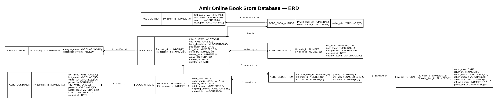

# Online Bookstore Database

An Oracle SQL and PL/SQL database project by Amir Saad for managing a bookstore catalogue, customers, orders, inventory, returns, and price-change history.



## Database design

The schema contains nine tables, nine sequences, six explicit indexes, one PL/SQL package, and six triggers. The package exposes seven procedures and four functions.

| Area | Tables |
|---|---|
| Catalogue | `AOBS_CATEGORY`, `AOBS_AUTHOR`, `AOBS_BOOK`, `AOBS_BOOK_AUTHOR` |
| Customers and sales | `AOBS_CUSTOMER`, `AOBS_ORDERS`, `AOBS_ORDER_ITEM` |
| Returns | `AOBS_RETURN` |
| Price history | `AOBS_PRICE_AUDIT` |

Primary keys, foreign keys, unique constraints, and check constraints define data integrity rules. The book–author junction table represents the many-to-many relationship between books and authors.

See the [data dictionary](docs/data-dictionary.md) and [vector ER diagram](docs/erd.svg) for the schema details.

## Repository contents

| File | Purpose |
|---|---|
| `sql/01_tables.sql` | Tables and constraints |
| `sql/02_sequences.sql` | Identifier and return-authorization sequences |
| `sql/03_indexes.sql` | Additional search and reporting indexes |
| `sql/04_package.sql` | `PKG_AMIR_BOOKSTORE` specification and body |
| `sql/05_triggers.sql` | Validation, inventory, totals, returns, and price-audit triggers |
| `sql/06_seed_data.sql` | Initial development records |
| `sql/07_validate.sql` | Schema and business-data checks |
| `setup.sql` | Complete installation entry point |
| `maintenance/reset.sql` | Explicit destructive development reset |
| `docs/` | Data dictionary and ER diagram |

## Setup

The source targets Oracle Database 12c. Connect using Oracle SQL Developer or SQL*Plus to a dedicated empty schema with privileges to create tables, sequences, indexes, procedures, and triggers, and sufficient tablespace quota.

Open `setup.sql` in SQL Developer and use **F5 (Run Script)**. For SQL*Plus, connect interactively without placing a password in the command, then run the setup file using its full path:

```sql
@/path/to/online-bookstore-db/setup.sql
```

The runner creates objects in dependency order, checks PL/SQL compilation errors, loads seed data, and displays validation results. Relative `@@` paths resolve from the containing SQL file. Review script output for errors. Oracle DDL commits implicitly, so an installation failure can leave partially created objects.

For an empty database without seed records, run only `sql/01_tables.sql` through `sql/05_triggers.sql`, in order.

## Seed data and validation

`sql/06_seed_data.sql` supplies development data so the database is usable immediately: 8 categories, 10 authors, 10 customers, 12 books, 15 book-author associations, 10 orders, 15 order items, 10 returns, and 10 generated price-audit records. Run it once after a fresh installation; it is not an incremental migration.

`sql/07_validate.sql` can be rerun independently. It reports table counts, object status, compilation errors, constraints, indexes, inventory, order totals, returns, and price history. Expect no compilation errors, valid objects, row counts meeting the displayed thresholds, and zero order-total differences. These are inspection queries, not a complete automated test suite.

## Reset a development database

`maintenance/reset.sql` drops the project's database objects and their data. Run it only when intentionally rebuilding a disposable development schema, then rerun `setup.sql`. The normal setup never invokes reset automatically.

## Business operations

`PKG_AMIR_BOOKSTORE` exposes:

- `ADD_BOOK` and `UPDATE_BOOK_PRICE` for catalogue maintenance.
- `PLACE_ORDER` and `UPDATE_ORDER_STATUS` for sales processing.
- `PROCESS_RETURN` for return processing.
- `GENERATE_WEEKLY_REPORT` and `GENERATE_MONTHLY_REPORT` for reporting.
- `GET_BOOK_STOCK`, `CALCULATE_ORDER_TOTAL`, `GET_CUSTOMER_TOTAL_SPENT`, and `IS_RETURN_ELIGIBLE` for queries and validation.

Package procedures leave transaction commits and rollbacks to the caller. Reporting procedures use `DBMS_OUTPUT`; enable server output in the client when using them.

## Verification

After installation, inspect compilation errors and object status:

```sql
SELECT name, type, line, position, text
FROM user_errors
WHERE name = 'PKG_AMIR_BOOKSTORE'
   OR name LIKE 'TRG_AOBS_%'
ORDER BY name, sequence;

SELECT object_name, object_type, status
FROM user_objects
WHERE object_name LIKE 'AOBS_%'
   OR object_name LIKE 'SEQ_AOBS_%'
   OR object_name LIKE 'TRG_AOBS_%'
   OR object_name = 'PKG_AMIR_BOOKSTORE'
ORDER BY object_type, object_name;
```

This repository cleanup preserves the supplied database logic. Static checks confirmed that SQL string literals were preserved and that presentation prompts and classroom commentary were removed; concise operational comments were retained. Oracle compilation and runtime behaviour have not been verified in this environment. Treat this as an academic database project, not a production-certified system.
